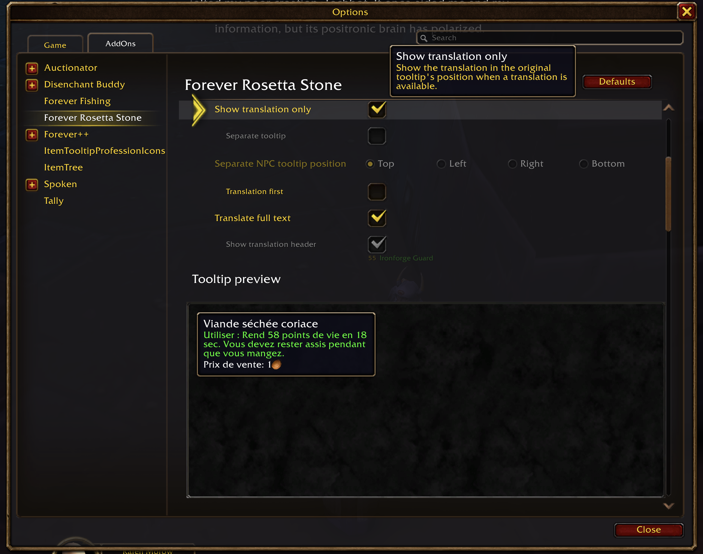
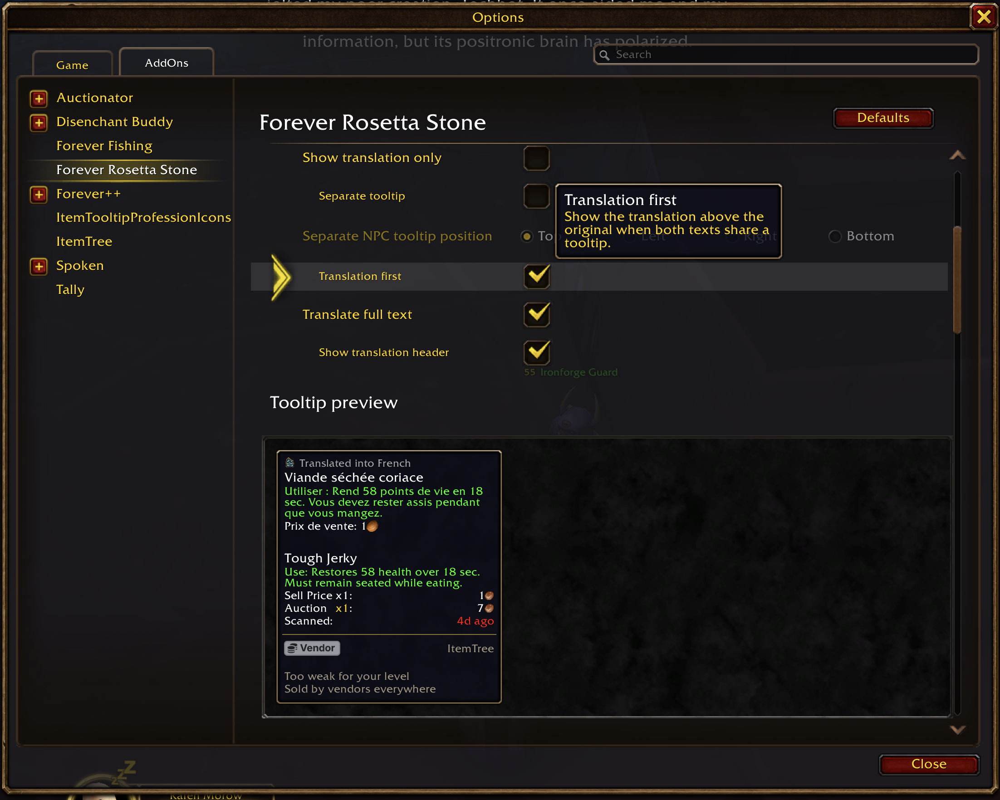

# Changelog

## [Unreleased]

### Added

- **Show translation only** puts the translated tooltip in the original position and hides the translation header. Tooltips without a translation stay in the game's language.

  

- **Above the original** puts the translation first when both texts share a tooltip.

  

- Read translated NPC greetings and conversation options, as well as quest offers, in-progress dialogue, and turn-in text beside the original window. Dialogue uses the appropriate wording for your character where variants are available.
- Choose separately whether NPC greetings, quest progress, and turn-in translations open automatically. Quest details and offers have their own setting, and you can still open a translation from the Rosetta Stone bookmark.
- When a quest, NPC dialogue, or book translation is missing, the panel explains what is missing and lets you copy a report to share on GitHub.

### Changed

- After choosing a language, pick one tooltip layout: translation below or above the original, a separate tooltip, or translation only. Full text and the translation header are grouped under **Tooltip content**.
- Quest, NPC dialogue, and book translations share a reading layout with aligned parchment and scrollbars. On a gamepad, use LT and RT to move focus between panels, B to close the focused translation, and the bookmark to reopen it. The translated book follows the page you turn in the original.
- Use the Options button on quest, dialogue, and book translations to report an issue, including when a translation is missing.
- Item reports from the picker include available transmogrification data for your own equipment and for inspected players.

### Fixed

- Fixed the translation panel closing when turning pages in books.
- Book and NPC dialogue bookmarks work again after `/frs reset`.
- Long item and spell names wrap inside quest reward buttons. Hovering a spell reward shows its translated tooltip.
- Guard dialogue keeps the game's option order and spacing. Missing option translations are identified, and Ironforge guards show the correct directions prompt.
- Fixed quest and dialogue tooltips briefly appearing as their translation panel opens.
- Quest tooltips on the map and in the quest list switch to the translation as soon as the tooltip opens, reducing flicker during gamepad navigation.
- Translated equipment comparisons stay beside the item tooltip and show updated values from other addons. When a tooltip contains interactive controls, **Show translation only** keeps them visible.
- The translated section of talent tooltips omits purchase requirements and their extra blank lines.
- Fixed untranslated appearance names under the transmogrification heading for supported equipped and inspected items.

### Translations

- Updated Vampiric Embrace in all 18 bundled languages for build 70959. The tooltip shows both the group healing and the caster's increased healing with the game's current values.
- Added Ironforge guard directions, including the bank, and support for the shared travel option at flight masters.
- Added equipment enchantment translations, including armor kits, weapon oils, poisons, sharpening stones, and fishing lures, in the 18 bundled languages where wording is available. Temporary effects retain the remaining time shown by the game.
- Added 20,209 dialogue entries across 4,493 quests and 1,565 NPCs in all 18 bundled languages.
- Refined 7,949 dialogue translations for quest and item terminology, meaning, and character gender. The review covered all 166,206 AI-translated dialogue entries.
- Expanded translations for 462 books and letters across all 18 bundled languages, covering 1,210 pages.
- Added 2 book titles and 61 pages to the catalog.

## [1.1.0] - 2026-11-19

### Translations

- Updated quest summaries and NPC names using the latest QuestieDB data for WoW Forever.
- Filled 504 gaps in quest summary translations across eight languages, including Italian, Polish, and Ukrainian.

## [1.0.2] - 2026-11-18

### Added

- Use `/frs questdata <quest IDs>` to collect a copyable report with native quest titles, objectives, journal text, and load status when available.

### Changed

- Updated tooltips for Flametongue Weapon, Windfury Weapon, Windfury Totem, Maelstrom Weapon, and Gloves of Holy Might for WoW Forever build 70959.

### Translations

- Added Ward of the Dead and updated two Darkspear care package titles across the 18 bundled languages.
- Korean clients use English fallback text for six Flametongue Weapon descriptions whose Korean source contains an invalid token.

## [1.0.1] - 2026-11-17

### Fixed

- Fixed stacked tooltip translations pausing the addon when a tooltip contains restricted client text.

### Changed

- The minimap icon turns red while translations are paused; click it to open the error report.

## [1.0.0] - 2026-11-16

### Added

- Initial release of **Forever Rosetta Stone**, exclusively for **WoW Forever**.
- Quest translations in a companion panel beside the original quest windows, including available titles, descriptions, objectives and rewards.
- Translated quest tooltips for the quest list, tracker, chat links, map markers and NPC quest offers, with supported live objective progress.
- Item, spell and talent tooltip translations, including supported effects, live values and equipment comparisons. Choose translations below the original tooltip or in a separate companion.
- Translations for supported profession recipes, reagents and tracked recipes; NPC and player details; mounts, companions, appearances, books, group finder activities and character stats.
- Zone and subzone translations on the map and minimap, with supported map navigation and tracking labels.
- Per-feature settings, mouse and native gamepad navigation, and an in-game console for collecting bug reports.
- A public translation database API for other addons. The normal UI and API can run together; optional API-only startup skips the FRS interface and its hooks.

### Translations

- Bundled translation data for 18 languages, available offline while playing.
- Game data, community translations and AI-generated or adapted translations, with source credits and AI indicators where applicable.

### Known limitations

- Coverage varies by language and content. Missing translations or unavailable decoding context can leave native text, an incomplete-translation notice, or no translated companion.
- Buff tooltips on native unit frames remain in the game's language, even when a translation exists.
- Designed for WoW Forever's native Blizzard UI. Compatibility with custom UI addons and tooltip replacements is unverified.
