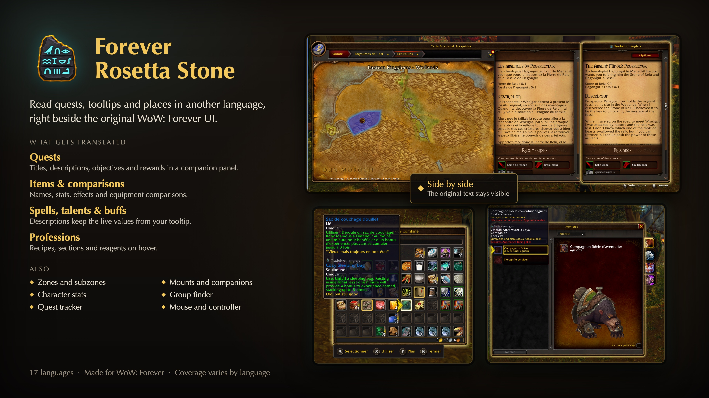
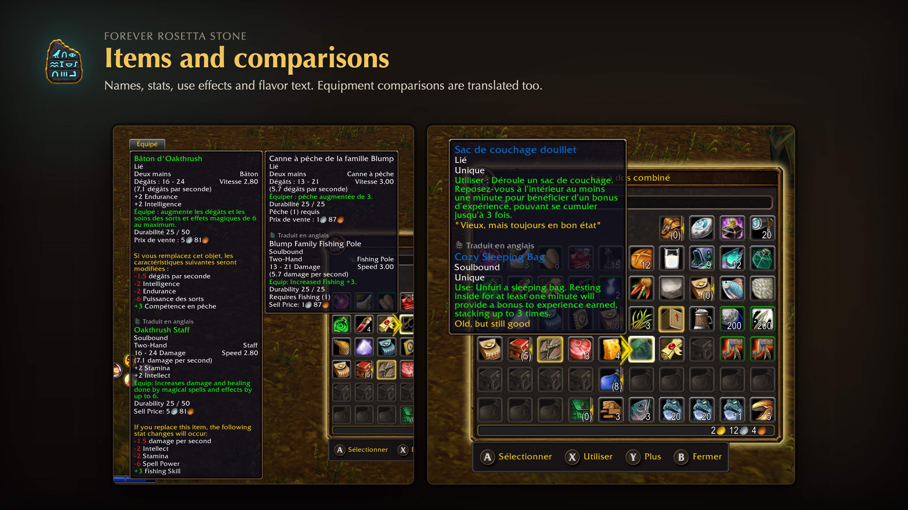
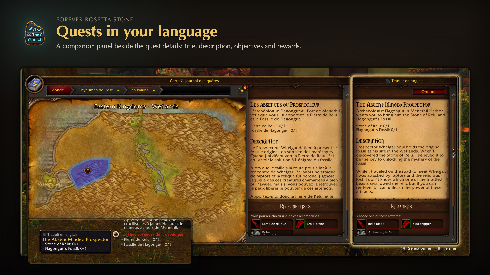

# Forever Rosetta Stone

Read quests, tooltips, and locations in another language while keeping the original game UI.

**Forever Rosetta Stone is an open-source addon licensed under the
[MIT License](https://github.com/rphlmr/forever-rosetta-stone/blob/main/LICENSE.md).**
Bundled third-party code, translations, and game data retain their original licenses,
terms, and attributions. See the
[third-party notices](https://github.com/rphlmr/forever-rosetta-stone/blob/main/ForeverRosettaStone/THIRD-PARTY.md)
for details.

I make Forever Rosetta Stone to give people the best experience I can with this awesome game
I've loved for years. **This project will remain WoW Forever only.** It's the only version I play,
and the only one I develop, test, and support this addon for.

## What gets translated

Choose a translation language and enable the features you want:

| In the game | What Forever Rosetta Stone adds |
| --- | --- |
| **Quests** | Quest titles, summaries, descriptions, supported objective text and live progress in a companion panel beside map details and NPC quest windows. |
| **Quest tooltips and markers** | Translations for the quest list, chat links, tracker, World Map markers, minimap quest markers, and NPC quest offers. |
| **Items and rewards** | Item names and available tooltip details, including supported stats, effects, and equipment comparisons. Quest rewards keep the game's live values. |
| **Professions** | Recipe and section names on hover in every profession's recipe list. Tracked recipes show translated names and live reagent counts. Each hover has its own option under Professions in settings. |
| **Spells and talents** | Names and available descriptions, with supported numeric values taken from the live tooltip. Buff and debuff descriptions are included where available. |
| **Collections** | Mount and companion summon tooltips, pet species names, and appearance names and shared instructions where translations exist. |
| **Group finder** | Translated dungeon, battleground and questing activity names on hover or controller focus. |
| **NPCs** | Creature names and supported tooltip details. Player names and custom pet names stay as they are. |
| **Locations** | Zone and subzone names, quest-list location headers, map hover labels, map navigation menus, and location labels beside the map. |
| **Minimap tracking** | Supported tracking-option labels. Service labels currently support English; tracking spells use your selected language. |
| **Character stats** | Supported stat and resistance explanations, keeping the game's displayed values. |

**Coverage varies by language and field.** A language being available does not mean every quest,
item, or description is translated. Missing translations can remain in the game's language,
show as incomplete, or have no translated companion.

**Known limitation:** buff tooltips on native unit frames currently remain in the game's language,
even when the buff's translation exists. See [unit-frame buff tooltips](https://github.com/rphlmr/forever-rosetta-stone/blob/main/docs/troubleshooting.md#unit-frame-buff-tooltips-remain-untranslated)
for the confirmed scope and client limitation.

## A companion to the original UI

Forever Rosetta Stone provides additional translated content: a quest panel, tooltip content, and location labels.
**It does not replace the game's original screens or text, and it will remain that way.**
The original game UI stays available alongside Forever Rosetta Stone's translations.

Tooltip translations appear below the original content by default. Check **Separate tooltip** for a
companion beside it. **Translate full text** is checked by default; uncheck it to translate names only.

The quest companion supports mouse and native gamepad navigation, with independent scrolling
for the original and translated panels.

Forever Rosetta Stone is designed for **WoW Forever's native Blizzard UI**. Custom UI addons such as ElvUI and
tooltip replacements are outside the supported scope. They may work, but compatibility with either
tooltip mode is unverified.

## Install and choose your language

1. Exit WoW and extract the addon ZIP into `World of Warcraft/_forever_/Interface/AddOns/`.
2. Keep **all included addon folders** together: `ForeverRosettaStone` and its translation data packs.
3. Launch WoW and enable Forever Rosetta Stone and its data packs.
4. Open **Settings > AddOns > Forever Rosetta Stone**, click the minimap icon, or run `/frs settings`.
5. Choose your translation language. English is the default.

Spoken, MultiLanguage, and Questie are not required. Translations come from the bundled database,
with no online translation service needed while you play.

See the [player guide](https://github.com/rphlmr/forever-rosetta-stone/blob/main/docs/player-guide.md) for settings, quest controls, and gamepad navigation.

## Translations and AI

The database combines game data, community translations, and translations generated or adapted with AI.
If a translation sounds wrong or misses the meaning, help me make it better. Share the language,
the original text, and your suggested correction. Improvements are welcome, whether it's one word
or a whole quest.

See the [translation contribution guide](https://github.com/rphlmr/forever-rosetta-stone/blob/main/CONTRIBUTING.md)
to submit a community translation or edit a catalog in a pull request.

### Capture text to report or translate

You do not need to know the item's, spell's or quest's ID:

1. Open the relevant game panel and run `/frs pick`.
2. Hover the element, or focus it with a controller, and let its tooltip or quest text appear.
3. Choose **Stop picking**, or run `/frs stop`, then select the captured entry.
4. Choose **Select output** and press **Ctrl+C / Cmd+C**. Paste the full report into a
   [GitHub issue](https://github.com/rphlmr/forever-rosetta-stone/issues/new), with your target
   language and suggested translation or correction. Add a screenshot if useful.

Button names follow your game's language. Reports include the element's identity, available
native text and client/addon details. Nothing is uploaded or added to the translation database
automatically. Copy your reports before starting another Pick session, which clears the list.
For controller-only report export, NPC dialogue and quest-specific reports, see the
[reporting guide](https://github.com/rphlmr/forever-rosetta-stone/blob/main/docs/troubleshooting.md#debug-console-and-reporting).

For missing text or addon problems, see [how to prepare a report](https://github.com/rphlmr/forever-rosetta-stone/blob/main/docs/troubleshooting.md).

## Sources and thanks

This project builds on the work of people who document the game and make it accessible in more languages.
Thank you to:

Forever Rosetta Stone is a free, noncommercial community addon. Game data is provided by
Blizzard Entertainment through the Battle.net API and client-data sources. World of Warcraft
and related trademarks and game content belong to Blizzard Entertainment, Inc. and their
respective owners. This project is independently developed and is not affiliated with,
endorsed by, or sponsored by Blizzard Entertainment.

- **Blizzard Entertainment**, for the game, its text, and its native UI.
- [Wago.tools](https://wago.tools/db2) and [QuestieDB](https://github.com/Questie/QuestieDB),
  for client data references, names, and quest relationships.
- [EG Link](https://github.com/JIVESCORP/eg-link-output-wowf), compiled by
  [Efficient Games](https://efficient.games), for native NPC and item text (CC BY 4.0).
- [Wowhead](https://www.wowhead.com/forever) and [Icy Veins](https://db.icy-veins.com/wow-forever/),
  for supplemental text and terminology references.
- [ClassicUA](https://github.com/greenya/ClassicUA), for Ukrainian translations and references.
- Italian translation context includes [WoWita-quests](https://github.com/deemonder/WoWita-quests)
  (Icedany and WoWita contributors), [WoWForeverIT](https://github.com/polletto/WoWForeverIT),
  and [WOW Forver - Italiano](https://github.com/z4mbo/WOW-Forver-Italiano).
  WoWForeverIT includes translations from **QuestIT by Drakanast**, maintained with the **QuestIT Discord
  community** and **[#italyforazeroth](https://italy-for-azeroth.vercel.app/)**. QuestIT's
  translation licence is separate from its code licence; retained terms are under
  `datasources/wow_forever_it/licenses/`.
- Additional Polish, Turkish and Ukrainian context comes from
  [WoWLang](https://github.com/DiNaSoR/WoWLang), credited to Platine, Dragonarab,
  Hakan YILMAZ and its community contributors. Turkish Vanilla context also comes from
  [QuestTranslator Vanilla Turkish](https://github.com/devteabct78/questtranslator-vanilla-turkish).

- [Czech Forever](https://www.curseforge.com/wow/addons/czechforever), by **Marek Lušovský**.
- [Forever Translated](https://www.curseforge.com/wow/addons/forever-translated), by **Ceridian**,
  for Polish translations.
- [Världen av Krigskraft](https://www.curseforge.com/wow/addons/varlden-av-krigskraft),
  by **Ninsew**, with archive author **Pontus**, for Swedish translations.
- [ForeverTR](https://www.curseforge.com/wow/addons/forevertr), by **Red Lion Labs**, for Turkish translations.
- [PolishForever](https://github.com/JSlomian/PolishForever), by **Jan Słomian**.
- [Spoken](https://github.com/rusty-key/spoken-wow), by **Rusty Key**, for quest-panel coordination
  code adapted in Forever Rosetta Stone.
- [Gethe's UI source mirror](https://github.com/Gethe/wow-ui-source/tree/forever),
  for references to the native UI.

The [catalog credits](https://github.com/rphlmr/forever-rosetta-stone/blob/main/ForeverRosettaStone/notices/catalog-credits.md) record source versions,
additional references, and contributors. [Third-party credits](https://github.com/rphlmr/forever-rosetta-stone/blob/main/ForeverRosettaStone/THIRD-PARTY.md)
and the [bundled notices](https://github.com/rphlmr/forever-rosetta-stone/tree/main/ForeverRosettaStone/notices/) retain the original licenses and terms.

Original project code and documentation are licensed under the
[MIT License](https://github.com/rphlmr/forever-rosetta-stone/blob/main/LICENSE.md).
Third-party code, translation data, and game content retain their respective terms.

## Use the database in your own project

You're welcome to use the database in your own addons, tools, or other projects.
Other addons can query the [public translation API](https://github.com/rphlmr/forever-rosetta-stone/blob/main/docs/api.md) while Forever Rosetta Stone is loaded.
The normal UI and API can run together. An optional API-only mode skips UI initialization;
see [startup modes and the developer example](https://github.com/rphlmr/forever-rosetta-stone/blob/main/docs/api.md#normal-ui-or-api-only-startup).
An independently loadable database-only addon is not available yet.

You may use, adapt, and redistribute my own database contributions for any purpose, provided you
credit **Raphaël (rphlmr)**, **Forever Rosetta Stone**, and the original data sources you use.
Third-party data keeps its original licenses and conditions, including any noncommercial or
share-alike requirements. Keep the relevant credits and license notices with anything you redistribute.

You're also welcome to fork the project and maintain a port for Retail or another WoW version.
Those ports would be maintained separately from this Forever-only project.

## Guides and project updates

- [Player guide](https://github.com/rphlmr/forever-rosetta-stone/blob/main/docs/player-guide.md): settings, tooltips, quests, and controller use.
- [Troubleshooting and reports](https://github.com/rphlmr/forever-rosetta-stone/blob/main/docs/troubleshooting.md): missing translations, diagnostics, and error recovery.
- [Changelog](https://github.com/rphlmr/forever-rosetta-stone/blob/main/CHANGELOG.md): player-facing updates.
- [Database and catalogs](https://github.com/rphlmr/forever-rosetta-stone/blob/main/docs/database.md): data boundaries, coverage, builds, and translation maintenance.
- [Catalog import and resync](https://github.com/rphlmr/forever-rosetta-stone/blob/main/docs/import-resync.md): source priority, language rules, verified updates, and regression coverage.
- [Translation API](https://github.com/rphlmr/forever-rosetta-stone/blob/main/docs/api.md): lookups for addon authors.
- [Development and validation](https://github.com/rphlmr/forever-rosetta-stone/blob/main/docs/development.md): architecture, tracing, profiling, and tests.
- [Releases](https://github.com/rphlmr/forever-rosetta-stone/blob/main/docs/releases.md): GitHub CI, ZIP packaging, and CurseForge publishing.
